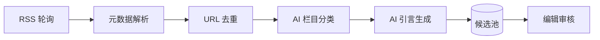

# 宁波银行设计周刊 — 技术方案

| 属性 | 内容 |
|------|------|
| 文档版本 | v1.0 |
| 创建日期 | 2026-06-16 |
| 代码仓库 | `NBCB-设计资讯/web` |

---

## 1. 技术选型

| 层级 | 选型 | 说明 |
|------|------|------|
| 框架 | Next.js 16 App Router | 与 moyuzhoukan 对齐，SSR + API Routes |
| UI | antd 6 + CSS Modules | NBCB Coffer 主题定制 |
| 语言 | TypeScript | 类型安全 |
| 数据（M0/M1） | JSON 文件 + 内存 Store | 快速验证；后续可换 SQLite/PostgreSQL |
| 部署 | Node.js / Vercel 兼容 | 静态+动态混合 |

**决策**：从 moyuzhoukan 复用 **工程模式**（App Router、antd Provider、API 结构），但 **不复用 Feed/收藏/登录** 模块，按周刊模型重写。

---

## 2. 数据模型

```typescript
type ArticleCategory = 'ui_design' | 'design_experience' | 'ai_frontier';
type ArticleStatus = 'candidate' | 'selected' | 'published' | 'rejected' | 'archived';
type IssueStatus = 'draft' | 'published' | 'unpublished';
type LinkStatus = 'link_ok' | 'link_broken' | 'link_unknown';

interface Article {
  id: string;
  title: string;
  original_url: string;
  source_name: string;
  published_at: string;
  category: ArticleCategory;
  introduction: string;
  language: 'zh' | 'en';
  link_status: LinkStatus;
  status: ArticleStatus;
  issue_id?: string;
  sort_order?: number;
  intro_reviewed: boolean;
}

interface WeeklyIssue {
  id: string;
  issue_number: number;
  title: string;
  publish_date: string;
  status: IssueStatus;
  cover_summary?: string;
  article_ids: string[];
}
```

---

## 3. API 设计

### 3.1 公开接口（无需鉴权）

| 方法 | 路径 | 说明 |
|------|------|------|
| GET | `/api/issues/latest` | 最新 published 周刊摘要 |
| GET | `/api/issues` | 归档列表 |
| GET | `/api/issues/[id]` | 周刊详情 + 文章 |
| GET | `/api/articles/[id]` | 文章落地页 |
| POST | `/api/articles/[id]/click` | 阅读原文点击计数 |

### 3.2 后台接口（Session 鉴权）

| 方法 | 路径 | 说明 |
|------|------|------|
| POST | `/api/admin/login` | 编辑登录 |
| GET | `/api/admin/session` | 会话检查 |
| POST | `/api/admin/logout` | 退出 |
| GET | `/api/admin/candidates` | 候选池 |
| PATCH | `/api/admin/articles/[id]` | 更新文章 |
| GET/POST | `/api/admin/issues` | 周刊列表/创建 |
| GET/PATCH | `/api/admin/issues/[id]` | 周刊详情/更新 |
| POST | `/api/admin/issues/[id]/publish` | 发布（含门禁） |

---

## 4. 抓取与 AI 引言管线（M2）



**M0/M1 实现**：`src/mocks/seed.json` 手工种子数据；后台「重新生成引言」返回模板化 Mock，预留 LLM API 接入点 `src/lib/intro-generator.ts`。

---

## 5. 鉴权方案

- 前台：完全匿名，无 Cookie 要求
- 后台：环境变量 `ADMIN_EMAIL` + `ADMIN_PASSWORD`，HttpOnly Session Cookie（8h）
- M2 可选：行内 SSO 对接

---

## 6. 目录结构

```
web/src/
├── app/
│   ├── page.tsx                 # 首页
│   ├── weekly/[id]/page.tsx     # 周刊详情
│   ├── weekly/current/page.tsx  # 重定向到首页（最新周刊等同首页）
│   ├── article/[id]/page.tsx    # 文章落地
│   ├── archive/page.tsx         # 归档
│   ├── about/page.tsx           # 关于
│   ├── admin/                   # 编辑后台
│   └── api/                     # REST API
├── components/
├── lib/
│   ├── store.ts                 # 数据读写
│   ├── theme.ts                 # NBCB 主题
│   └── intro-generator.ts       # AI 引言（Mock）
├── mocks/seed.json              # M0 种子数据
└── types/index.ts
```

---

## 7. 修订记录

| 版本 | 日期 | 说明 |
|------|------|------|
| v1.0 | 2026-06-16 | 初版，基于 Next.js 16 + JSON Store |
